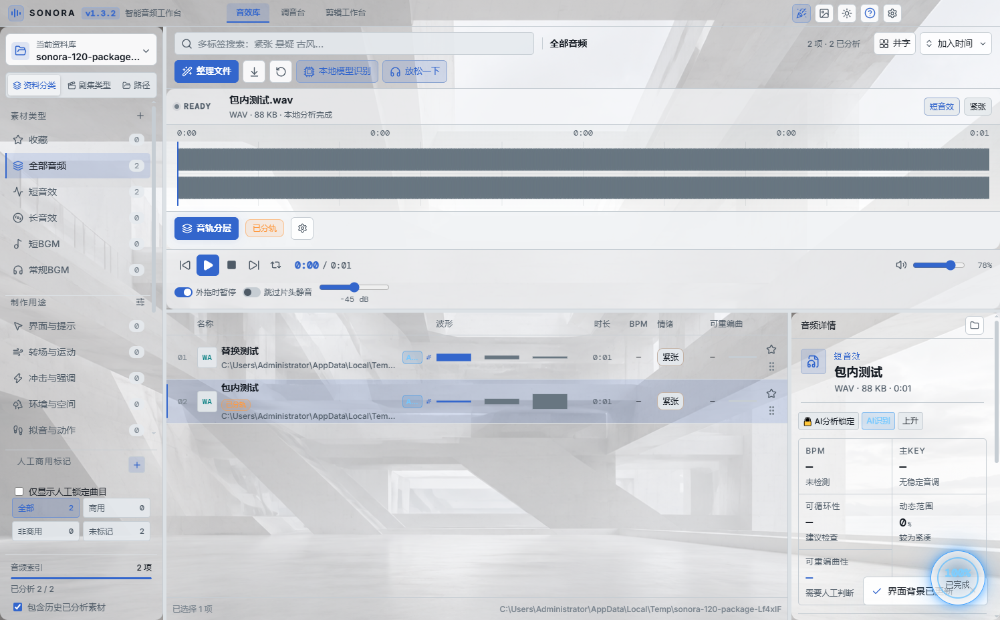

*音效库主界面历史截图（1.3.2），使用测试素材展示；当前正式版为1.5.6。*

# Sonora 音效库 · 1.5.8

面向剪辑师、配乐师及媒体从业者的本地音频素材工作站：查找、试听、打标、变调，并将素材拖入剪辑软件。

## 下载与升级

[下载最新正式版](https://github.com/foxmailhot/sonora/releases/latest) · [所有版本与更新记录](https://github.com/foxmailhot/sonora/releases) · [反馈 BUG](https://github.com/foxmailhot/sonora/issues)

首次安装或从旧版升级，请运行发布页的 **升级安装包 EXE**。从 1.2.4 开始，Windows 安装版在启动后自动检查并下载正式版更新；保存工作后确认安装，不会无提示关闭软件。设置内可关闭自动检查，或手动检查更新。便携版和 Mac 请手动下载，不宣称支持自动替换安装。

资料库保存于用户“文档 / Sonora 音效库数据”，不在安装目录中。**1.5.8采用新标签体系，不兼容旧分类标签**：旧标签不作为新标签的真值；界面需要时会要求明确选择“备份并重建标签”，不能将新旧标签数量直接比较。原音频、波形/声学结果、收藏与商用标记保留。升级前请退出程序并保留完整一致资料库备份，运行中不能只复制SQLite主文件而忽略WAL；回退需使用旧程序及升级前备份。1.5.8 当前发布包为 Windows x64；没有本次已验证的 Mac 安装包。便携版默认可能共用本机资料库，不要同时运行多个版本。

## 1.5.8 更新

- 修复大资料库识别时界面内存不足退出的风险：列表使用轻量模型摘要，解码前检查内存预算，激进调度同时考虑界面进程余量；完整分析仍在本地保留。超预算文件待续识别，不误记为损坏。意外退出后可明确恢复界面，但不会自动重启识别，本地诊断不上传。
- 优化识别任务的实际管线调度：长文件不再占住完整的GPU文件槽，WebGPU仅在真正提取声学特征时占用计算槽；短音频与CPU任务可继续补位。界面区分排队、解码、CPU工作线程和实际GPU特征执行/回退，不把任务数或Windows“3D”读数当成GPU利用率。
- 动态激进模式继续依据实测CPU空余、可用内存及在途PCM预算逐步放量；约95%是扣除其他程序负载后的调度目标，不是保证CPU/GPU占用率。保留内存、取消和前台交互保护；长文件仍受实际解码与内存条件限制。
- CPU工作线程处理特征、BPM和KEY，复用单声道数据，减少渲染线程运算和重复副本。内置MN模型仍为本地CPU ONNX运行，按资源情况使用有限线程并预取下一段解码；没有新增CUDA依赖，也不宣称整条模型管线已GPU化。
- 素材大类统一为BGM、音效、混合，人工确认立即生效且保持唯一。证据不足的素材暂放“混合”并明确待复核，同时可在BGM与音效两侧查到；这不是模型已经确认两种声音同时存在。人工明确选为音效或混合后，不再被旧BGM路径名强行改成音乐抽样计划。
- 规则更新后可在后台低功耗纠正受影响的冲突标签，默认开启；识别中心与标签反馈页共享开关，支持手动执行、暂停、继续与停止。只回放本地标签规则，不重新解码原音频或调用外部AI；商用授权不跨素材自动传播，波形、BPM、KEY等声学数据不被标签纠正改写。
- 完善人工复核、缩略波形、预计剩余时间和断点续识别的交互，保留已提交结果，识别与复核使用各自明确的进度和状态。

[查看1.5.8发布说明与下载](https://github.com/foxmailhot/sonora/releases/tag/v1.5.8)。仅公开安装包、更新元数据、校验文件与项目说明，不公开完整开发源码，不上传用户资料库、原音频或个人反馈。合成素材基准仅代表对应固定测试，不能推算实机整库收益；本轮不宣称已完成真实原地升级/卸载、macOS或分类准确率验收。

## 1.5.7 更新

- 高精度主轨波形更稳定：同一素材的标签、收藏和后台模型结果更新不再清空波形；首次补齐内容哈希也不重复加载，真实文件变化仍会刷新。保留8192点按需高精度波形，不扩大持久化波形缓存。
- “继续上一次识别”先选择本次模式与模型参数，再确认开始；支持均衡、全速、动态激进和静默。队列每批最多64项，增量写回，停止或重启后继续未完成位置，不在点击续跑时拉取整库。
- 默认跳过输入身份、算法阶段和新标签版本均为当前的结果；模型补充独立核对所选权重、预处理与标签映射。过期或文件变化时不冒充最新，声学有效但模型过期时只补模型；明确重算可取消跳过。
- “十路极限”改为动态激进：按实测CPU负载、可用内存和在途预算逐步调整，目标使用扣除其他程序负载后的CPU容量约95%，并非保证占用率或让所有硬件固定占满95%。保留内存与前台加工/导出保护，资源不足保留位置，不写成音频损坏。
- 短音频优先CPU；长音频有可用WebGPU时优先GPU特征管线，异步独立调度并复用CPU工作线程。解码、BPM、KEY及内置MN模型仍使用CPU，GPU不可用或失败时回退CPU，不把检测到CUDA等同于模型GPU加速。

[查看1.5.7发布说明与下载](https://github.com/foxmailhot/sonora/releases/tag/v1.5.7)。本次公开安装包、更新元数据、校验文件与项目说明，不公开完整开发源码，不上传用户资料库、原音频或个人反馈。升级前退出程序并备份完整一致资料库；本轮验证未执行真实原地升级/卸载，不承诺实机整库吞吐或GPU提速。

## 1.5.6 更新

- 修复识别中心显示“上一次识别尚未完成”卡片后，三个页签被压缩、被正文遮挡和无法点击的问题；页签、恢复卡及正文独立布局，正文单独滚动。
- 识别入口统一为“开始识别”，进行中显示进度；停止后可继续上一次任务，也支持重启后恢复未完成队列，已保存结果不重复分析。
- 新标签矩阵提供折叠分组、自定义声音标签、最近20项与多标签独立两秒确认动画；“情绪”和“使用场景”合并为“情绪营造”。最深有效目录优先、文件名其次；冲突可在人工复核中快速纠正。
- “放松一下”改为“人工复核”，支持1/2/3快捷确认BGM/音效/混合、跳过与纠正上一首；相似素材改为更重/更轻/更长/更短等方向建议。
- 可自定义临时分轨目录；迁移需再次确认脱链风险，复制校验后保留旧文件，不替外部剪辑软件修改素材引用。
- 64个测试文件、424项自动测试通过；源码和最终安装包各36个布局案例通过，最终包另通过38项标签、复核与续识别检查。更新组件以1.3.2/1.5.5旧版本适配器检测并从本地测试源下载1.5.6安装包，SHA512一致；不是已实测旧安装原地覆盖。
- 上述界面测试使用隔离资料库和合成素材，不访问真实用户库。未实测Mac、真实剪辑软件接收、安装升级/卸载、长期大库压力；不宣称90%准确、零卡顿或GPU分轨加速。Windows包未数字签名。

[完整更新说明与数据提醒](https://github.com/foxmailhot/sonora/releases/tag/v1.5.6)。本仓库仅公开安装包、更新文件和介绍，不公开完整Sonora开发源码。第三方组件仍各自遵守原许可证：随附FFmpeg GPLv3构建的[对应源码](https://github.com/FFmpeg/FFmpeg/commit/e38092ef93)、[lamejs LGPL3](https://github.com/shijinyu/lamejs)、[SoundTouchJS MPL2](https://github.com/cutterbl/SoundTouchJS/tree/v2.1.1)；模型来源与授权边界见发布附件MODEL_LICENSES.md。

## 本地音乐分轨（自1.3.2起）

点击主波形正下方的高亮“音轨分层”，选择曲目和两轨/四轨模式，再确认开始。多轨保存默认开启，输出到原曲目录，也可另选目录；取消保存后仅临时使用，输出到安装位置的 Sonora-Stems。重名自动编号，不覆盖原曲。可查看进度和取消，关闭窗口后任务仍可继续。

内置 HT-Demucs ONNX 模型（约 158 MiB），使用本机 CPU，不上传音频。提供人声＋伴奏，或人声＋鼓＋贝斯＋其他乐器。输出目录需支持硬链接（Windows NTFS）。本版未提供主唱/和声细分、文字指定任意声源、GPU 加速；CPU 处理可能慢于音频时长。不保证完全无残留。

模型作者 Simon Rouard、Francisco Massa、Alexandre Défossez / Meta：[原始 Demucs](https://github.com/facebookresearch/demucs)。ONNX 转换 StemSplit：[demucs-onnx](https://github.com/StemSplit/demucs-onnx)，[权重及 MIT 模型卡](https://huggingface.co/StemSplitio/htdemucs-onnx)。许可证随安装包提供。

## 1.3.2 操作更新

- 修复分轨弹窗的层级与裁切，低分辨率和高缩放下底部按钮可操作。
- 多轨时间码使用固定宽度和等宽数字；显示约 10Hz 刷新，波形播放头独立逐帧移动，保留 8192 点高精度波形。
- 多轨道保存默认开启；整曲适配窗口宽度，无横向滚动条。轨道颜色由主题 / 自定义 RGB 生成同色系分层，框体遵循壁纸底色不透明度。
- 剪辑工作台合并结果数量与标题信息，压缩搜索、排序和筛选区，为素材列表留出空间。
- 原算法失败与不可解码文件保留在分析异常，输入未变化时不再自动重试；本地模型的单文件失败也记入存档。修复文件后更新链接再继续分析。
- 从资源管理器将音频文件或整个文件夹拖入音效库主面板即可更新链接，不复制原素材、不自动分析。优先匹配原路径与内容，唯一同名 / 大小可恢复标签，歧义或哈希不一致不套用旧分析。
- 248 项单元回归、TypeScript / Vite 和真实打包界面检查通过；分轨弹窗覆盖 1280×720、2048×1152 / 125%、3840×2160 / 150%。Mac、旧安装原地升级及外部剪辑软件接收未实测。

## 1.3.1 操作更新（历史）

- 三个界面主波形正下方统一音轨分层：两轨 / 四轨、进度、2×彩色波形、逐轨开关发声和直接外拖。
- 调音台分离当前 BGM，确认后清空已加入音效。分层使用源文件，不烘焙变调或 I/O 参数。
- 多轨道保存默认关闭，临时文件保存在安装位置的 Sonora-Stems；开启后可另存，默认原曲目录。红色清理按钮有脱链风险二次警告，只清理登记的临时结果。
- 橙色已分轨标签调取旧结果，先核对源文件与输出存在性；保护既有锁定和标签。
- 剪辑台新增面板拖动调节，三页圆角和主题统一；帮助补充操作及安全提醒，可铺满窗口，保留历史图文教程。
- GPU / DirectML 在本机兼容测试失败，没有将不稳定 GPU 组件默认内置；当前包用 CPU 和已有结果复用，不宣称 GPU 提速。

## 基本使用（当前版）

1. 打开资料库，选择音频目录；路径页也可浏览尚未分析的素材。
2. 单击曲目试听，点击顶部波形可定位；资料分类、标签、收藏和搜索帮助查找。
3. 在顶部“开始识别”统一配置并确认，可叠加本地声音事件模型；停止后保留已完成结果并可继续上一次任务。
4. 音效工作台和剪辑工作台提供筛选、试听和变调。将素材直接拖入剪辑软件；加工文件须生成完成后才可外拖。
5. 右键可编辑人工标签、转码、查看分析信息。人工/AI 锁定标签受保护。

本地声音事件分数不是正确率；情绪与剪辑场景建议仍需试听确认。不同编码文件可能损坏或受保护，支持扩展名不等于能修复损坏的文件。丢失原文件仅隐藏显示，不删除存档；实际存在但不能解码的素材保留诊断记录，未变化时不自动重复识别；新体系不再提供旧“技术合集”分类。

## 1.3.1 更新

- 修复调音台素材数量存在但列表不可见的问题；排序、搜索和文件视口不再抢占布局区域。
- 调音台左右路径页真实读取所选文件夹，能显示资料库之外、尚未分析的音频；路径浏览不自动识别，也不写入资料库。
- 主界面和两侧目录采用独立可取消的分页会话，修正隐藏筛选、旧分页及深滚动造成空列表的情况。
- 新增自定义主题点缀色：输入 RGB / #RRGGBB、使用颜色选择器或屏幕吸管（按 Esc 取消）。
- 壁纸设置增加“框体底色不透明度”，只改变背景，不整体降低文字、按钮和波形透明度。
- 229 项测试与打包界面回归通过，覆盖 1280×720、1480×920、2048×1152/125%；吸管真实屏幕像素选择、覆盖安装及 Mac 未自动化实测。

## 1.2.5 更新

- 音效库、音效工作台和剪辑工作台增加排序下拉菜单，默认新加入的音频排在最前面。
- 支持按名称、时长、BPM、文件修改时间和可重编曲性排序；剪辑工作台保留综合推荐、匹配度与项目使用次数。
- 加入时间保存在本地资料库，重新分析、收藏和编辑标签不会刷新。旧记录无法准确追溯加入日期，排在新记录后面。
- 列表与井字视图共享排序；切换排序不清除筛选和选中项。
- 224 项测试、真实打包界面与本地更新下载校验通过；未运行覆盖安装。

## 1.2.4 更新

- 增加 GitHub Releases 正式版自动检查、下载进度和确认升级；断网不阻塞编辑。
- 保留 1.2.3 收藏筛选、丢失文件隐藏、档案保护与工作台试听流程。
- 完善技术来源、本地模型说明及赞赏入口。

## 使用的开源技术

Sonora 本身的版权与第三方组件的许可证分别适用。下面列出工程中直接使用的主要项目及作者/维护者；[完整解析依赖来源清单](THIRD_PARTY_COMPONENTS.md) 包含传递依赖。“参考项目”不等于随安装包分发。

| 项目 | 作者 / 维护者 | 用途 / 源地址 |
| --- | --- | --- |
| Electron | Electron 社区 / OpenJS Foundation | 桌面与原生拖放：[electron/electron](https://github.com/electron/electron) |
| React | Meta 与 React 贡献者 | 界面：[facebook/react](https://github.com/facebook/react) |
| SQLite | SQLite developers | 本地事务存储：[sqlite/sqlite](https://github.com/sqlite/sqlite) |
| stream-json | Eugene Lazutkin | 大档案流式导入：[uhop/stream-json](https://github.com/uhop/stream-json) |
| FFmpeg / ffmpeg-static | FFmpeg developers / eugeneware contributors | 解码、转码：[FFmpeg/FFmpeg](https://github.com/FFmpeg/FFmpeg)，[eugeneware/ffmpeg-static](https://github.com/eugeneware/ffmpeg-static) |
| SoundTouchJS / audio-worklet | Steve “Cutter” Blades 与贡献者 | 保持时长变调：[cutterbl/SoundTouchJS](https://github.com/cutterbl/SoundTouchJS) |
| lamejs / BreezyStack 分支 | Alex Zhukov / shijinyu | MP3 编码：[zhuker/lamejs](https://github.com/zhuker/lamejs)，[shijinyu/lamejs](https://github.com/shijinyu/lamejs) |
| Lucide | Eric Fennis 与贡献者 | 图标：[lucide-icons/lucide](https://github.com/lucide-icons/lucide) |
| Vite / React 插件 | Evan You 与 Vite 贡献者 | 构建：[vitejs/vite](https://github.com/vitejs/vite)，[vitejs/vite-plugin-react](https://github.com/vitejs/vite-plugin-react) |
| TypeScript | Microsoft 与贡献者 | 类型检查：[microsoft/TypeScript](https://github.com/microsoft/TypeScript) |
| electron-builder / electron-updater | Vladimir Krivosheev 与贡献者 | 安装包与更新：[electron-userland/electron-builder](https://github.com/electron-userland/electron-builder) |
| Vitest | Vitest 贡献者 | 回归测试：[vitest-dev/vitest](https://github.com/vitest-dev/vitest) |
| concurrently | Open CLI Tools 贡献者 | 开发任务：[open-cli-tools/concurrently](https://github.com/open-cli-tools/concurrently) |
| cross-env / wait-on | Kent C. Dodds 与贡献者 / Jeff Barczewski | 构建辅助：[kentcdodds/cross-env](https://github.com/kentcdodds/cross-env)，[jeffbski/wait-on](https://github.com/jeffbski/wait-on) |

## 使用的模型与本地运行组件

- **EfficientAT MN04 / MN10**：Florian Schmid 等；[官方代码与权重](https://github.com/fschmid56/EfficientAT)，[原始发布页 v0.0.1](https://github.com/fschmid56/EfficientAT/releases/tag/v0.0.1)。Windows 包内使用 FP32 ONNX 转换模型，对 AudioSet 527 类声音事件进行推理。代码 MIT；原始权重没有在本次核验中找到单独明确的授权条款，不能将代码 MIT 当作权重再分发许可。
- **ONNX Runtime**：Microsoft 与贡献者；[microsoft/onnxruntime](https://github.com/microsoft/onnxruntime)，内置轻量 CPU 推理运行组件。
- **Python**：Python Software Foundation；[python/cpython](https://github.com/python/cpython)，用于独立模型进程。
- **NumPy**：NumPy 贡献者；[numpy/numpy](https://github.com/numpy/numpy)。运行组件还包含 [protobuf](https://github.com/protocolbuffers/protobuf)、[FlatBuffers](https://github.com/google/flatbuffers)、[coloredlogs](https://github.com/xolox/python-coloredlogs)、[humanfriendly](https://github.com/xolox/python-humanfriendly)、[SymPy](https://github.com/sympy/sympy)、[mpmath](https://github.com/mpmath/mpmath)；作者和许可证以各项目与随附组件文件为准。
- **AudioSet**：Google Research；[数据集与类别说明](https://research.google.com/audioset/)。只使用类别索引/映射，不分发 AudioSet 原始音频。
- **PyTorch / ONNX**：模型转换与开发验证使用，[pytorch/pytorch](https://github.com/pytorch/pytorch)，[onnx/onnx](https://github.com/onnx/onnx)；不是轻量安装包内的推理后端。
- **Essentia / YAMNet**：算法研究参考，[MTG/essentia](https://github.com/MTG/essentia)，[tensorflow/models YAMNet](https://github.com/tensorflow/models/tree/master/research/audioset/yamnet)；未内置其模型。

模型识别在本机运行。可选云端 AI 需要用户填写自己的接口密钥并确认调用，不随安装包提供密钥；模型名称与可用性由对应服务提供商决定。

## 版权与赞赏

软件版权归 **xixiwenjia@qq.com** 所有，软件免费。如果通过收费途径获取，请申请退款，可将售卖渠道信息发送到上述邮箱。第三方组件保留各自作者版权和许可证；本页面不是将整个 Sonora 工程授权为 MIT 的声明。

**如果觉得这个软件不错，也赞赏一下作者吧！**

感谢每一位支持 Sonora 的同行，愿你今天灵感常在、好音常伴。

